# K5-APRS

APRS station firmware for the Quansheng UV-K5: receive, beacon, digipeat,
send and receive messages and run as a KISS TNC, all from a $30 handheld.

This is K5-APRS 0.9.1. It grew out of **[uv-k5-minimal](https://github.com/nsnw/uv-k5-minimal)**, a small
from-scratch firmware for the same radio. The low-level drivers come from
the open UV-K5 firmware projects (see [Credits](#credits)); everything above
them is new, and was mostly written by Claude (see [Yes, an AI wrote this](#yes-an-ai-wrote-this)).

> [!WARNING]
> - **Back up your EEPROM first** (`k5 backup eeprom.bin` while the stock firmware
>   is running). K5-APRS keeps its settings at `0x0000`–`0x00FF`, over the start of
>   the stock channel memory. Factory calibration (`0x1E00`–`0x1FFF`) is only read.
> - **It transmits.** You need an amateur radio licence. It only transmits on the
>   6 m, 2 m, 1.25 m and 70 cm amateur bands, at the radio's calibrated low power.
> - Tested on one UV-K5 (DP32G030, BK4819, bootloader 2.00.06). Other variants
>   haven't been tried.

## Screenshots

Rendered from the firmware's own drawing code (`test/screens.sh`), so they
match the radio's 128×64 LCD pixel for pixel.

| | |
|:---:|:---:|
| 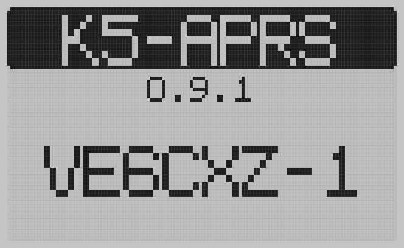<br>Boot screen | 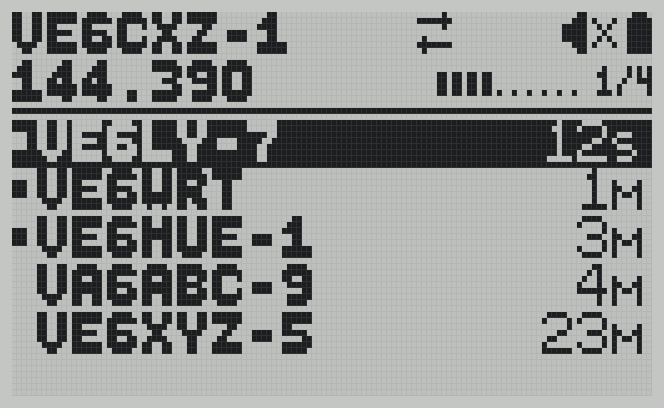<br>Stations, newest first |
| 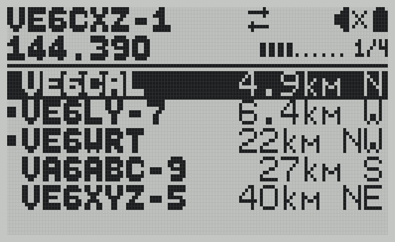<br>Stations, nearest first | 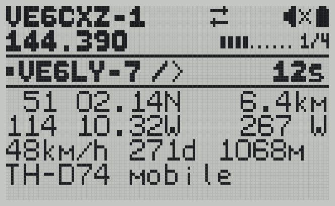<br>Station details |
| 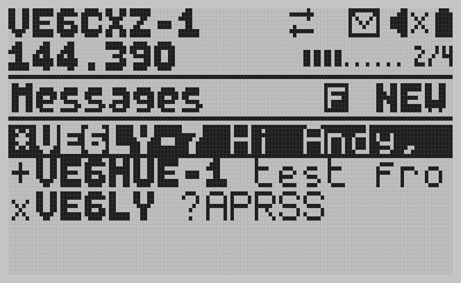<br>Messages | 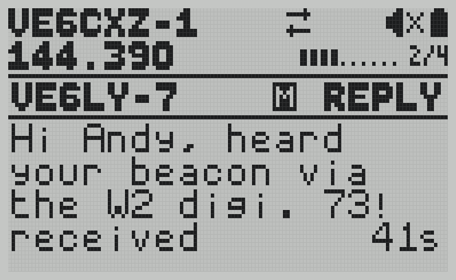<br>Reading a message |
| 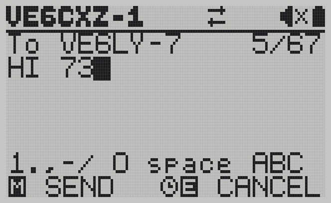<br>Writing a reply | 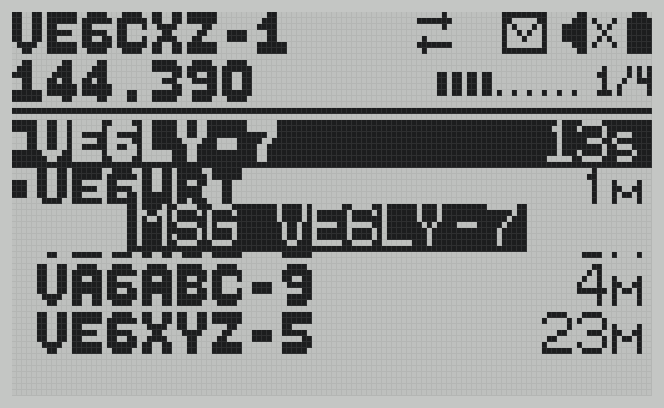<br>A new message arriving |
| 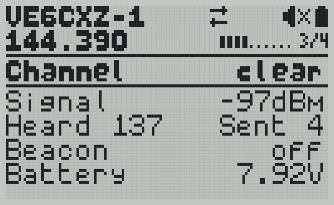<br>Radio | 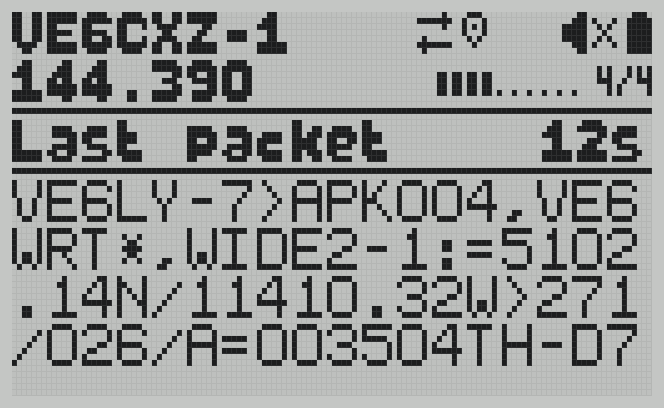<br>The last packet heard |
| 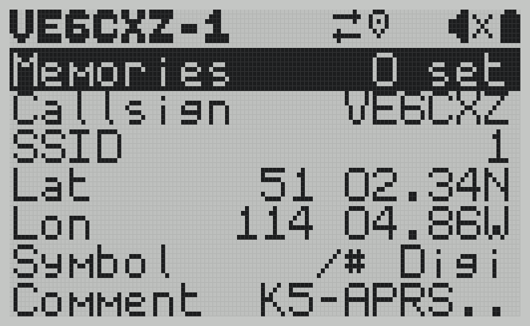<br>Settings | 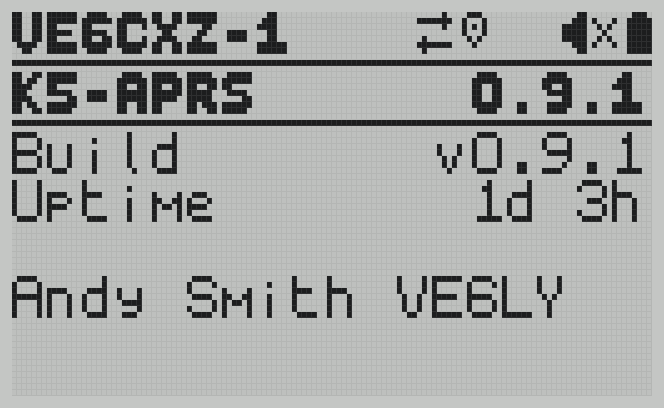<br>About |

## Features

- **Receive APRS** (1200 baud AFSK) on any frequency in the bands above. The
  default is 144.390 MHz (North America), and the last frequency is remembered.
- **Station list**: the 16 most recently heard stations, with position,
  distance and direction from you, speed, course, altitude, path and comment.
  Sort it by time or by distance; stations heard direct are marked, and the
  details name the digipeater you heard the others through.
- **Beacon**: a position report, a status report (`>text`, no position) or
  both, on demand or automatically every 1–1440 minutes. Without a position
  (none typed in, e.g. a digipeater) it sends the status report, so a
  callsign is all it needs. Symbol chosen on the radio from a list of common
  ones.
- **Digipeater**: WIDEn-N (New-N paradigm) up to a set number of hops, or
  fill-in only (WIDE1-1), with duplicate suppression.
- **Messages**: received messages are acked automatically, including
  reply-acks and messages relayed by IGates, and announced with a beep. Send
  and reply from the keypad; unacknowledged messages are retried every 30 s,
  up to 5 times. Inbox of 8.
- **Queries**: answers the standard directed queries sent as messages:
  `?APRSP` (position), `?APRSS` (status), `?APRST` / `?PING?` (route trace)
  and `?APRSD` (stations heard direct).
- **Remembers** the inbox and the station list across power-off.
- **KISS TNC** on the programming cable for APRS programs (Xastir, YAAC,
  APRSIS32, …); `k5 kiss serve` turns it into a KISS-over-TCP server.
  It switches to KISS only on a complete, valid KISS frame (or hold `*`), so
  line noise can't flip it, and only AX.25 UI frames (PID F0) are transmitted.
- **10 memories** with 6-character names, and a memory mode that shows the
  name instead of the frequency.
- **On-radio settings**: callsign, SSID, position, comment, path, beacon,
  digipeater and TX timing, all from the keypad.
- **A short beep** after each beacon, message, ack or query answer this station
  sends (not digipeated or KISS frames); **TX beep** in the settings turns it off.
- **The front LED**: red while transmitting, a green flash for each packet
  decoded, green while you hold PTT to monitor, yellow while a beacon,
  message or ack waits for a clear channel, and a short yellow blink every
  2 s while there are unread messages.
- **An optional receive beep** (**RX beep**, off by default): a short low tone
  for each new station (`NEW`) or every new packet (`ALL`), but not for
  digipeated copies of one just heard or your own packets coming back.
- **A careful transmitter**: amateur bands only, only where the radio has a
  factory power calibration, calibrated low power, at most 3 s per frame,
  and only once the channel is clear (p-persistent CSMA).

## The screen

The status bar along the top shows:

- your callsign (`KISS` while the TNC is on, `NO CALL` until you set one)
- two arrows while the digipeater is on, and a map pin while the auto-beacon
  is on. Each blinks if it's on but the current frequency can't transmit.
- a blinking envelope while there are unread messages
- a speaker: sound waves while receiving or monitoring, crossed out when idle,
  inverted while transmitting
- the battery, upright, with four bars

On the four pages the status bar has a second line: the frequency (in memory
mode, the memory's name instead), a signal meter, and the page number (`2/4`). A frequency you're typing shows
there too.

Below it are the pages. `SIDE1` and `SIDE2` go to the previous and next
page, and `EXIT` goes back to **Stations**. The pages other than Stations have a
header, a line, then their content.

1. **Stations** (the home page): five stations at a time. A dot before a
   callsign means it was heard direct, not through a digipeater. At the right
   of each row is how long ago it was heard, or, sorted by distance, how far
   away it is and in which direction (`12.4km NE`).
2. **Messages**: the inbox (`F` also goes straight here).
3. **Radio**: whether the channel is clear or busy, the signal in dBm,
   packets heard and sent, when the next automatic beacon goes out, and the
   battery voltage.
4. **Packet**: the last packet heard, as TNC2 text
   (`VE6LY-7>APK004,VE6WRT*,WIDE2-1:=5102.14N/...`), and how long ago. Four
   lines; the end of a long packet is cut off.

The settings and the text editors (writing a message, a comment, a name) keep
a one-line status bar.

Stations and messages from before the radio was switched off show their age
as `old`: there's no clock while it's off. Key hints show `MENU` and `EXIT`
as small inverted **M** and **E** icons.

`test/screens.sh` renders all of these; see [Building](#building).

## Keys

### Main screen

| Key | Action |
|---|---|
| `SIDE1` / `SIDE2` | Previous / next page (Stations, Messages, Radio, Packet) |
| `EXIT` | Back to the station list, from the details or another page |
| `0`–`9` | Type a frequency (it shows on the status bar). The first 3 digits are MHz (`1 4 4 3 9` = 144.390); `*` places the point yourself, `MENU` confirms, `EXIT` deletes (hold: cancel). In memory mode a digit goes to that memory instead. |
| hold `0`–`9` | Go to that memory |
| hold `EXIT` | Switch between frequency and memory mode |
| `UP` / `DOWN` | Select a station (Stations page) |
| `*` | Sort the stations by time (newest first) or by distance (nearest first; needs your position) |
| `MENU` | Station details: position, distance and bearing, speed, altitude, how it was heard, comment (`EXIT` goes back; `F` writes a message to that station, then comes back here) |
| hold `MENU` | Settings, including the digipeater and auto-beacon switches |
| `F` (`#`) | Messages page; on it, write a new message |
| hold `F` | Send your beacon now |
| hold `*` | KISS TNC on / off |
| PTT | Monitor: opens the speaker while held |

PTT never transmits: everything K5-APRS sends is an APRS packet.

### Messages page (`F`)

| Key | Action |
|---|---|
| `F` | Write a new message (the header shows the hint) |
| `UP` / `DOWN` | Select a message |
| `MENU` | Read it |
| `MENU` while reading | Reply, or send again if it wasn't delivered (the header shows which) |
| hold `EXIT` while reading | Delete the message |
| `EXIT` | Back (from the list: to the station list) |

While you're typing a message the side keys belong to the text editor
(`SIDE1` is upper/lower case), so they don't change the page.

In the list, `*` marks unread messages. Sent messages show `>` while waiting
for an ack, `+` once delivered and `x` if there was no ack or it was rejected.
A new message beeps twice (turn it off with **Msg beep** in the settings).

Queries aren't stored: `?APRSP` sends your position beacon, `?APRSS` your
status report (the **Status** text, or the firmware version), `?APRST` and
`?PING?` reply with the path the query took, and `?APRSD` with the stations
heard direct in the last 30 minutes. At most one answer every 10 s.

### Settings (hold `MENU`)

Memories, Callsign, SSID, Lat, Lon, Symbol, Comment, Path, Beacon type, Status,
Auto beacon, Beacon every,
Digipeater, Digi hops, Msg beep, TX beep, RX beep, TX delay, TX tail, About.

`UP`/`DOWN` move and change values, `MENU` edits and saves, `EXIT` cancels or
closes. In **Memories**, `MENU` tunes to a memory, hold `MENU` stores the
current frequency and names it, and hold `EXIT` clears it.

**Beacon type**: `POS` sends a position report (a status report if no
position is set), `STATUS` only the status report, `BOTH` both. **Status** is
the status text (up to 62 characters; empty sends the firmware name and
version), also the answer to `?APRSS`. **Symbol** steps through common APRS
symbols (person, car, van, truck, bicycle, house, digipeater, weather ...);
others can be set with `k5 beacon set --symbol`. **About** shows the version,
the build (git commit), how long the radio has been on and the author;
`MENU` or `EXIT` goes back.

### Typing text

Callsigns, names, the comment and messages use phone-style entry: `2` is
A B C 2, and pressing it again within a second moves to the next letter.

| Key | Action |
|---|---|
| `0`–`9` | Letters and digits (`0` = space, `1` = punctuation) |
| `UP` / `DOWN` | Step through every character at the cursor |
| `*` / `F` | Cursor left / right |
| `SIDE1` | Upper / lower case |
| `EXIT` | Delete (hold: cancel) |
| `MENU` | Done |

The hints along the bottom show the punctuation and space keys, the case
(`ABC` / `abc`), `MENU`'s action and hold `EXIT` to cancel. A small clock
before a key means hold it.

Writing a message is one screen: **To** with the callsign and SSID as one
field (`VE6LY-7`; `1` types the `-`), then the text, with its length at the
right. `MENU` moves from the callsign to the text, then sends; `EXIT` with no
text yet goes back to the callsign. A reply starts in the text.

## Getting started

1. Back up the EEPROM while the stock firmware is still running (see [Tools](#tools)).
2. Flash K5-APRS: download it from
   [Releases](https://github.com/nsnw/uv-k5-aprs/releases) (`.packed.bin` for
   web flashers and `k5prog`, `.bin` for `k5 flash`; a receive-only build is
   there too), or build it yourself (below).
3. Hold `MENU` and set your callsign and SSID; optionally your position,
   symbol and status text.
4. Tune your local APRS frequency. Hold `F` to beacon; turn on **Auto beacon**
   and **Digipeater** in the settings to beacon automatically and digipeat.

## Building

Needs Docker (Colima, Rancher Desktop or Docker Desktop all work):

```sh
./build.sh                         # uses the current docker context
DOCKER_CONTEXT=colima ./build.sh   # or pick one
./build.sh clean
```

Output goes to `build/`:

- `k5-aprs.packed.bin`: for any UV-K5 flasher (web flashers, `k5prog`, `uvtools`)
- `k5-aprs.bin`: the raw image, for `k5 flash`
- `k5-aprs.elf` and `.map`: for debugging

With a native `arm-none-eabi-gcc` and `python3 -m pip install crcmod`, plain
`make` works too. `./build.sh ENABLE_TX=0` builds a receive-only firmware that
never keys the transmitter. The version number is set in the `Makefile`.

The host tests (decoder/encoder loopback, digipeater, KISS, messages and
queries, menu, beacon, distance/bearing, EEPROM storage) run with the system
C compiler: `test/run.sh`.

`test/screens.sh` renders screenshots of every main screen (boot, station
list and details, messages, beacons, settings, KISS) into `build/screens/`,
with an `index.html` to page through them. It runs the firmware's own drawing
code on the host with the hardware stubbed out and example stations and
messages loaded, so the PNGs match the LCD pixel for pixel. Edit
`test/screens.c` to add screens or change the examples.

## Tools

The `k5` command-line tool flashes the radio, backs up the EEPROM, configures
the station, shows decoded packets and runs the KISS TNC. See
[tools/README.md](tools/README.md).

```sh
python3 -m venv .venv && .venv/bin/pip install -e tools
.venv/bin/k5 backup eeprom.bin   # with the stock firmware running
.venv/bin/k5 flash               # bootloader mode: hold PTT while switching on
.venv/bin/k5 aprs                # decoded packets, live
```

## How it works

- **Receiving.** The UV-K5 has no audio path back to the MCU, so the BK4819's
  own FSK receiver is used as a raw Bell 202 bit slicer: its sync word is set
  to the NRZI image of the APRS flag preamble, and the raw bits that follow
  are decoded in software (NRZI, bit unstuffing, FCS) in `src/ax25.c`.
- **Transmitting.** The BK4819's tone generator is switched between 1200 and
  2200 Hz at 1200 baud, timed from SysTick (`src/tx.c`, `src/hdlc_tx.c`).
- **Everything else** (parsing, digipeater, beacon, messages, KISS, the UI)
  lives in `src/`, one module per job; each header starts with a description.

### EEPROM layout

| Address | Contents |
|---|---|
| `0x0000`–`0x000F` | Settings: frequency, memory mode, squelch, backlight |
| `0x0010`–`0x004F` | Beacon: callsign, SSID, symbol, position, path, comment |
| `0x0050`–`0x005F` | Station: TX delay and tail, digipeater, beacon interval |
| `0x0060`–`0x00FF` | 10 memories |
| `0x0100`–`0x04FF` | Message inbox |
| `0x0500`–`0x0BFF` | Station list |
| `0x0C00`–`0x0C47` | Beacon type and status text |
| `0x1E00`–`0x1FFF` | Factory calibration (read only) |

## Notes

- Packets go to the destination `APZK5M`. `APZ` is APRS's experimental range;
  a registered tocall would come from [aprs-deviceid](https://github.com/aprsorg/aprs-deviceid).
- The station list is saved at most every 5 minutes, to spare the EEPROM
  (about a million writes per page), so the last few minutes can be lost at
  power-off. Messages are saved within seconds.
- Distances use a flat-earth approximation: within about 1% at VHF/UHF ranges.

## Yes, an AI wrote this

Most of this firmware was written by [Claude](https://claude.ai) (Anthropic's AI) working in
Claude Code, with me (Andy, VE6LY) choosing what it should do, testing every build on a real radio
and on the air, and deciding what stayed. The design calls and the bugs found the hard way are mine;
most of the typing isn't.

If you're about to open an issue or post a comment complaining that it's AI-written: don't
bother. That kind of complaint will be mocked and then ignored as tedious bullshit. Bug reports,
fixes and good ideas are welcome, whoever or whatever wrote them.

## Credits

K5-APRS stands on the work of the UV-K5 firmware community. The drivers,
start-up code, register definitions and firmware packer come from these
Apache-2.0 projects; [NOTICE](NOTICE) lists exactly what was taken.

- **DualTachyon**: the open re-implementation of the UV-K5 firmware that made
  all of this possible ([uv-k5-firmware](https://github.com/DualTachyon/uv-k5-firmware))
- **OneOfEleven**, **egzumer** and **armel (F4HWN)**: the custom firmware forks
  ([OneOfEleven](https://github.com/OneOfEleven/uv-k5-firmware-custom),
  [egzumer](https://github.com/egzumer/uv-k5-firmware-custom),
  [armel](https://github.com/armel/uv-k5-firmware-custom))
- **sq5bpf**: [k5prog](https://github.com/sq5bpf/k5prog), which documented the
  bootloader and EEPROM protocol the `k5` tool speaks
- **ARM**: CMSIS 5 headers (Apache-2.0), in `external/CMSIS/`

## References

- [APRS Protocol Reference 1.0.1](http://www.aprs.org/doc/APRS101.PDF): positions, messages, acks
- [APRS 1.1 reply-acks](http://www.aprs.org/aprs11/replyacks.txt)
- [The New-N paradigm](http://www.aprs.org/fix14439.html): WIDEn-N digipeating
- [AX.25 Link Access Protocol 2.2](https://www.tapr.org/pdf/AX25.2.2.pdf) (TAPR)
- [KISS](http://www.ka9q.net/papers/kiss.html) (Chepponis and Karn)
- [aprs-deviceid](https://github.com/aprsorg/aprs-deviceid): destination callsigns (tocalls)
- [Dire Wolf](https://github.com/wb2osz/direwolf): the reference software TNC, handy for testing

## Licence

Apache License 2.0: see [LICENSE](LICENSE) and [NOTICE](NOTICE).
Copyright 2026 Andy Smith, VE6LY.
